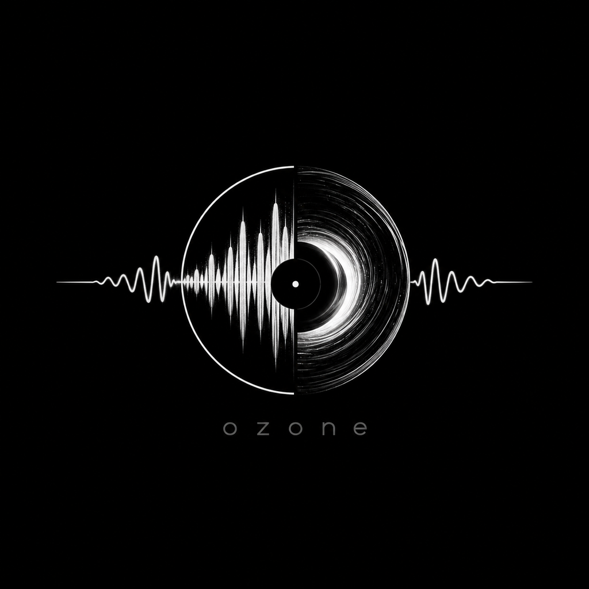
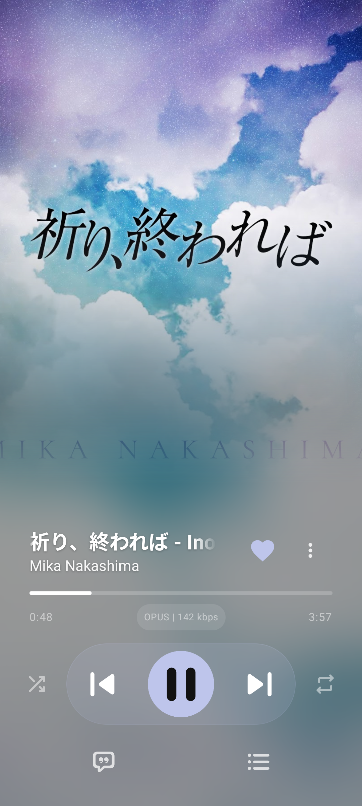
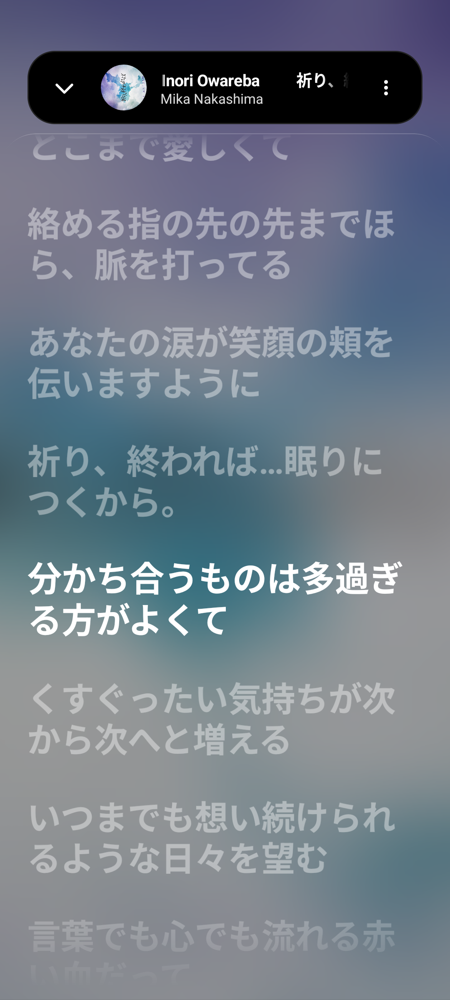
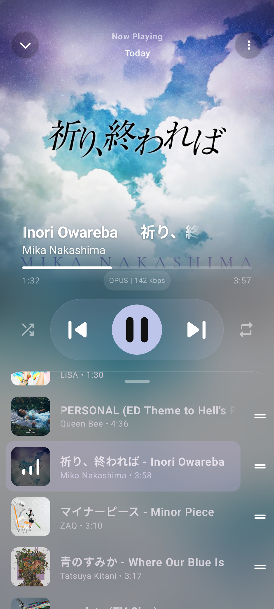
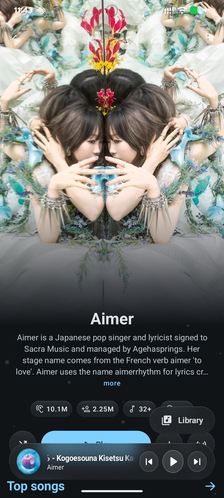
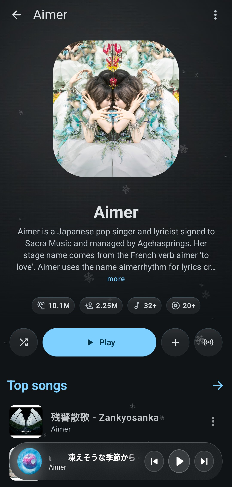
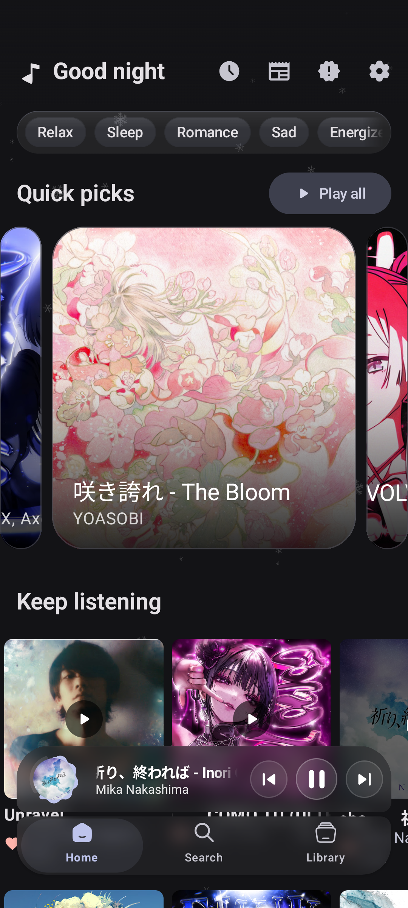
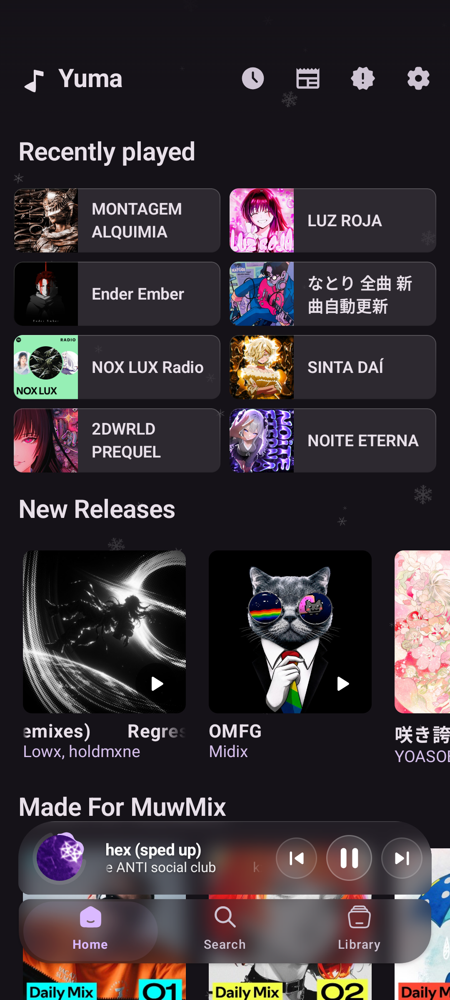
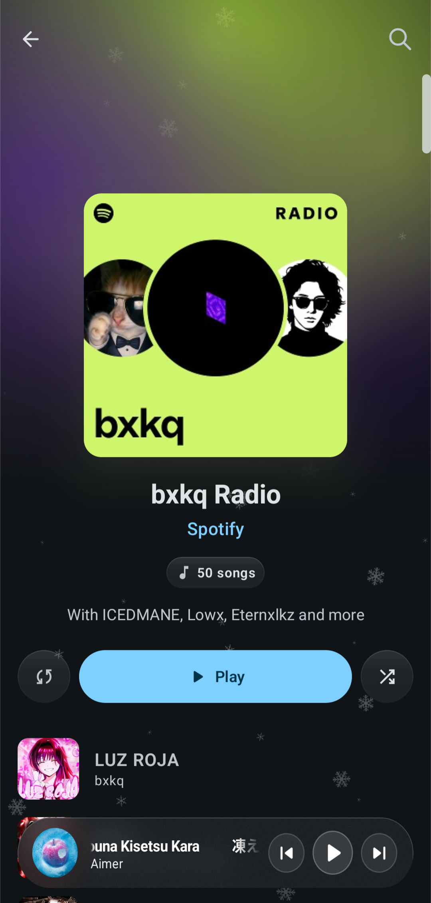
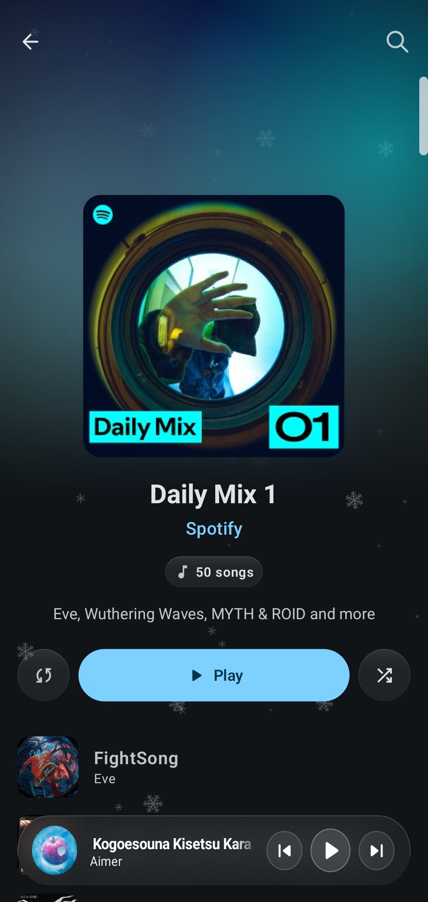

<div align="center">

  

  <h1>Ozone Player</h1>

  <p align="center">
    <a href="README.md">
      
    </a>
    <a href="README_RU.md">
      
    </a>
  </p>


  <p align="center">
    <strong>Гибридный музыкальный плеер для Android с акцентом на удобство, дизайн и качественный звук.</strong>
    <br />
    <em>Spotify UI + Алгоритмы рекомендаций + База YouTube Music + Hi-Res Lossless (FLAC) + Dual Play.</em>
  </p>

  <p align="center">
  <a href="#-галерея-интерфейса-showcase"><b>Скриншоты</b></a> •
  <a href="#-основные-возможности"><b>Возможности</b></a> •
  <a href="#-архитектура-и-документация"><b>Архитектура</b></a> •
  <a href="#-установка-и-загрузка"><b>Скачать</b></a> •
  <a href="#-участие-в-разработке-contributing"><b>Внести вклад</b></a> •
  <a href="#-поддержать-проект-support"><b>Донат</b></a>
  </p>

  <div>
    
    
    
    
  </div>

</div>

---

## 🌟 О проекте

**Ozone Player** — это независимый открытый музыкальный плеер для Android, объединяющий каталоги и функции двух ведущих платформ со стримингом и воспроизведением локальных треков в Hi-Res качестве.

Проект создан на основе **ArchiveTune** (с наработками от **Metrolist** и **SimpMusic**), вдохновлен механикой очередей **PixelPlayer**, сетевым взаимодействием со Spotify из **Meld** и стримингом FLAC из **Stash**. На этом фундаменте создана модульная архитектура из 20 модулей, собственная дизайн-система **Ozone Design System** и плавная жестовая модель с аппаратным ускорением.

Никаких платных подписок, встроенной рекламы, аналитики и закрытых трекеров. Учетные данные шифруются локально на устройстве (AES-256-GCM via Google Tink), а исходный код полностью открыт под лицензией GPL-3.0.

---

## 📸 Галерея интерфейса (Showcase)

<div align="center">
  <table>
    <tr>
      <td width="33%" align="center">
        <br />
        <sub><b>Главный плеер (FLAC & Glass)</b></sub>
      </td>
      <td width="33%" align="center">
        <br />
        <sub><b>Синхронизированный текст</b></sub>
      </td>
      <td width="33%" align="center">
        <br />
        <sub><b>Очередь воспроизведения</b></sub>
      </td>
    </tr>
    <tr>
      <td width="33%" align="center">
        <br />
        <sub><b>Постер артиста</b></sub>
      </td>
      <td width="33%" align="center">
        <br />
        <sub><b>Morphing Header</b></sub>
      </td>
      <td width="33%" align="center">
        <br />
        <sub><b>Главный экран</b></sub>
      </td>
    </tr>
    <tr>
      <td width="33%" align="center">
        <br />
        <sub><b>Лента Spotify</b></sub>
      </td>
      <td width="33%" align="center">
        <br />
        <sub><b>Радио и Миксы Spotify</b></sub>
      </td>
      <td width="33%" align="center">
        <br />
        <sub><b>Daily Mix</b></sub>
      </td>
    </tr>
  </table>
</div>

---

## ✨ Основные возможности

### 🎛️ Аудиодвижок, Dual Play и Smart Automix
* **Dual Play (Бета):** Воспроизведение двух аудиопотоков одновременно с разделением каналов (L/R) или общим микшированием и независимой регулировкой громкости.
* **Dual-Deck бесшовный кроссфейд:** Настоящее непрерывное воспроизведение треков внахлест с двумя независимыми синхронизированными деками.
* **DJ Transition Intelligence:** Автоматический анализ точек входа/выхода, BPM-сопоставление и частотная фильтрация баса.
* **Аудиофильский тракт:** 24-битная упакованная обработка PCM, приоритетный Kopus декодер с fallback на MediaCodec.
* **Smart Stall Recovery:** Автоматическая деградация кроссфейда при сетевых задержках и мгновенное возобновление потока.
* **N+1 Prefetching:** Умная фоновая подгрузка следующих композиций в локальный кэш.

### 🔄 Гибридный режим (Spotify + YouTube Music)
* **Каталог Spotify:** Нативный просмотр альбомов, Daily Mixes, Discover Weekly и плейлистов с дедупликацией треков.
* **Каталог YouTube Music:** Полнотекстовый поиск, чарты, категории настроений и радиостанции.
* **SponsorBlock:** Пропуск спонсорских вставок, интро и завершений.

### 🎧 Lossless FLAC и Локальный звук
* **Прямой FLAC:** Стриминг и загрузка оригинальных треков Hi-Res Lossless.
* **Бесшовный фоллбэк:** При отсутствии Lossless-версии трек гладко воспроизводится из YouTube Music (Opus / AAC).
* **Локальная музыка:** Полноценный встроенный плеер для аудиофайлов на памяти телефона (FLAC, MP3, AAC, OGG, WAV).
* **Тонкая настройка звука:** Встроенный 5-полосный эквалайзер, нормализация громкости (EBU R128), изменение темпа и тональности, таймер сна.

### 🎤 Продвинутая Лирика и AI-перевод
* **3-уровневый синхрон:** Одновременный показ оригинального текста (Кандзи/Хангыль), транслитерации (Ромадзи) и перевода.
* **Караоке-скролл:** Точная синхронизация по времени через 6+ провайдеров (LRCLIB, Kugou, BetterLyrics, SimpMusic, Unison, YouLyPlus).
* **AI-перевод на лету:** Мгновенный перевод текста песен прямо во время воспроизведения.
* **Карточки цитат:** Возможность сохранить фрагмент текста как стильную картинку для соцсетей.

### 🎨 Ozone Design System и Плавность
* **Стеклянный интерфейс (Glass UI):** Полупрозрачные карточки, тонкие рамки, выверенная геометрия скруглений.
* **Dual-Sheet жесты:** Независимые шторки плеера без конфликтов жестов и тряски списков.
* **Morphing Header:** Плавное сжатие постера артиста или альбома в строке состояния при скролле.
* **Динамический Monet:** Адаптивная генерация темы и акцентов на основе палитры текущей обложки трека.

---

## 🏛️ Архитектура и Технологический стек

Ozone Player — многомодульный Android-проект, построенный по канонам Clean Architecture и однонаправленного потока данных (UDF):

* **UI и Дизайн:** Jetpack Compose, дизайн-токены Ozone Design System, аппаратно-ускоренные Haze-оверлеи.
* **Аудиодвижок:** Media3 (ExoPlayer), `:core:audio-dsp` (Dual Play, Smart Automix, DJ filter cascade).
* **Данные и Хранилище:** Room ORM, шифрованные защищенные настройки (AES-256-GCM via Google Tink).
* **Сеть и Прием данных:** Ktor/Retrofit, InnerTube (движок YouTube Music).

📖 **Подробная документация для разработчиков:**
* [Обзор архитектуры и граф модулей](docs/architecture/ARCHITECTURE.md)
* [Архитектурные решения (ADR)](docs/architecture/DECISIONS.md)
* [Руководство по компонентам](docs/design/COMPONENT_GUIDE.md)
* [Стандарты кода и правила](docs/development/CODING_STANDARD.md)

---

## 📥 Установка и Загрузка

<div align="center">
  <table>
    <thead>
      <tr>
        <th align="center">GitHub Releases</th>
        <th align="center">Obtainium</th>
      </tr>
    </thead>
    <tbody>
      <tr>
        <td align="center">
          <a href="https://github.com/aswadhkrishna22-prog/OzonePlayer/releases/latest">
            
          </a>
        </td>
        <td align="center">
          <a href="https://apps.obtainium.imranr.dev/redirect?r=obtainium://add/https://github.com/aswadhkrishna22-prog/OzonePlayer">
            
          </a>
        </td>
      </tr>
    </tbody>
  </table>
</div>

### Сборка из исходников
```bash
git clone https://github.com/aswadhkrishna22-prog/OzonePlayer.git
cd OzonePlayer
./gradlew assembleRelease
# Готовый APK появится в: app/build/outputs/apk/release/
```
*Требования:* свежая версия Android Studio с поддержкой AGP, JDK 21, Android SDK 37 (compileSdk/targetSdk 37, minSdk 26).

---

## ⚙️ Подключение аккаунтов

Ozone Player полностью функционален без логина. Авторизация нужна только для подтягивания ваших личных плейлистов и рекомендаций:

<details>
<summary><b>🎵 Подключение Spotify</b></summary>

1. Откройте **Настройки** → **Аккаунт** → **Spotify** → Нажмите **Войти**.
2. Авторизуйтесь под своими учетными данными на открывшейся веб-странице.
3. Сессия будет автоматически сохранена и зашифрована на устройстве.
</details>

<details>
<summary><b>📺 Подключение YouTube Music</b></summary>

Доступно два удобных способа входа:
* **Способ 1 (Google Аккаунт):** Откройте **Настройки** → **Аккаунт** → **YouTube** → войдите через встроенное безопасное окно авторизации.
* **Способ 2 (Ввод токена / Cookie):** Если у вас включена двухфакторная аутентификация или не открывается браузер — перейдите в **Настройки** → **Аккаунт** → **Редактор токенов** и вставьте актуальные cookie сессии вручную.
</details>

---

## ☕ Поддержать проект (Support)

Ozone Player распространяется бесплатно, не содержит рекламы и не продает подписки. Если плеер вам понравился и вы хотите поддержать автора:

- Поставьте звезду репозиторию на [GitHub](https://github.com/aswadhkrishna22-prog/OzonePlayer) ⭐
- Отправляйте отзывы и отчеты об ошибках через экран «Сообщить о проблеме» в приложении!

---

## 💡 Участие в разработке

Мы рады любому вкладу сообщества — от исправления багов до предложений новых функций:

* Ознакомьтесь с **[Правилами участия](CONTRIBUTING.md)** перед отправкой кода или созданием Pull Request.
* Сообщайте о найденных багах через наш [трекер проблем GitHub](https://github.com/aswadhkrishna22-prog/OzonePlayer/issues).

---

## 🤝 Благодарности (Open-Source Credits)

Проект создан благодаря наработкам и свободному коду сообщества:

* **[ArchiveTune](https://github.com/rukamori/ArchiveTune)** — за отличный фундамент, плеерные наработки и базу настроек.
* **[Meld](https://github.com/FrancescoGrazioso/Meld)** — за концепцию и реализацию гибридного взаимодействия со Spotify.
* **[Stash](https://github.com/rawnaldclark/Stash)** — за вдохновение в организации Lossless FLAC стриминга и загрузок.
* **[Metrolist](https://github.com/mostafaalagamy/Metrolist)** & **[SimpMusic](https://github.com/maxrave-dev/SimpMusic)** — за первоначальные парсеры текстов и интерфейсные идеи.
* **[PixelPlayer](https://github.com/theovilardo/PixelPlayer)** — за идеи кинематики жестов и организацию очереди.
* **[QBDLX](https://github.com/ImAiiR/QobuzDownloaderX)** — за инфраструктуру прямого Lossless аудио.
* **[LRCLIB](https://lrclib.net/)** & **[BetterLyrics](https://better-lyrics.boidu.dev/)** — за открытую базу синхронизированной лирики.

---

## ⚖️ Лицензия и Отказ от ответственности

### Лицензия
Ozone Player распространяется под свободной лицензией **GNU General Public License v3.0 (GPLv3)**. 
Вы можете свободно использовать, изучать, модифицировать и распространять код при условии сохранения авторских прав и открытия производного кода под аналогичной лицензией GPL-3.0.

### Отказ от ответственности (Disclaimer)
Ozone Player — это независимый неофициальный сторонний клиент. Проект **не связан с Google LLC, YouTube Music или Spotify AB** и не одобрен ими. Приложение создано исключительно для личного использования и управления собственной медиатекой.

---

<p align="center">
  Разработано с ❤️ и вниманием к каждому кадру. Enjoy the music! 🎵
</p>
